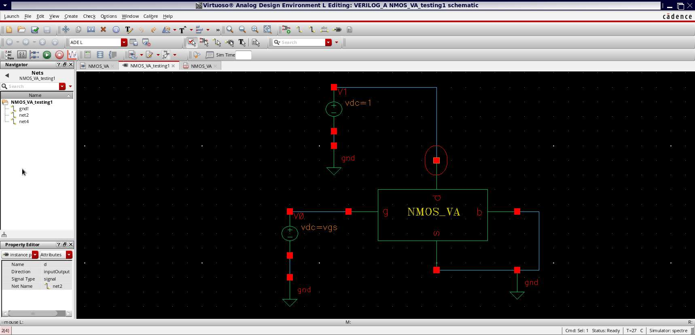
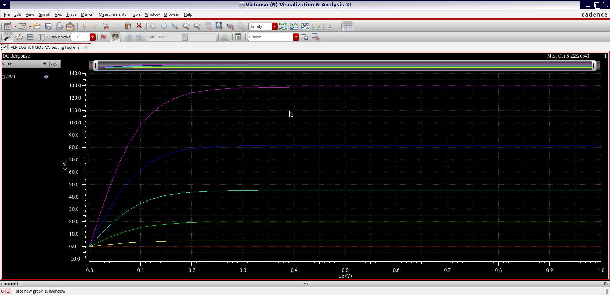
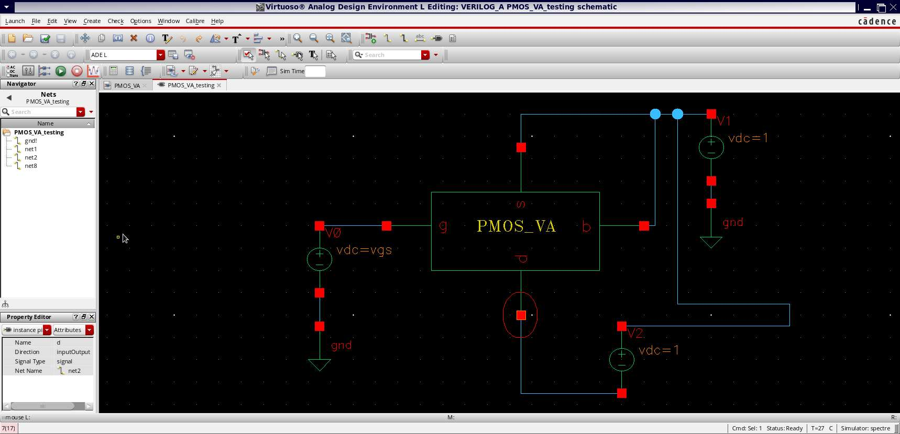
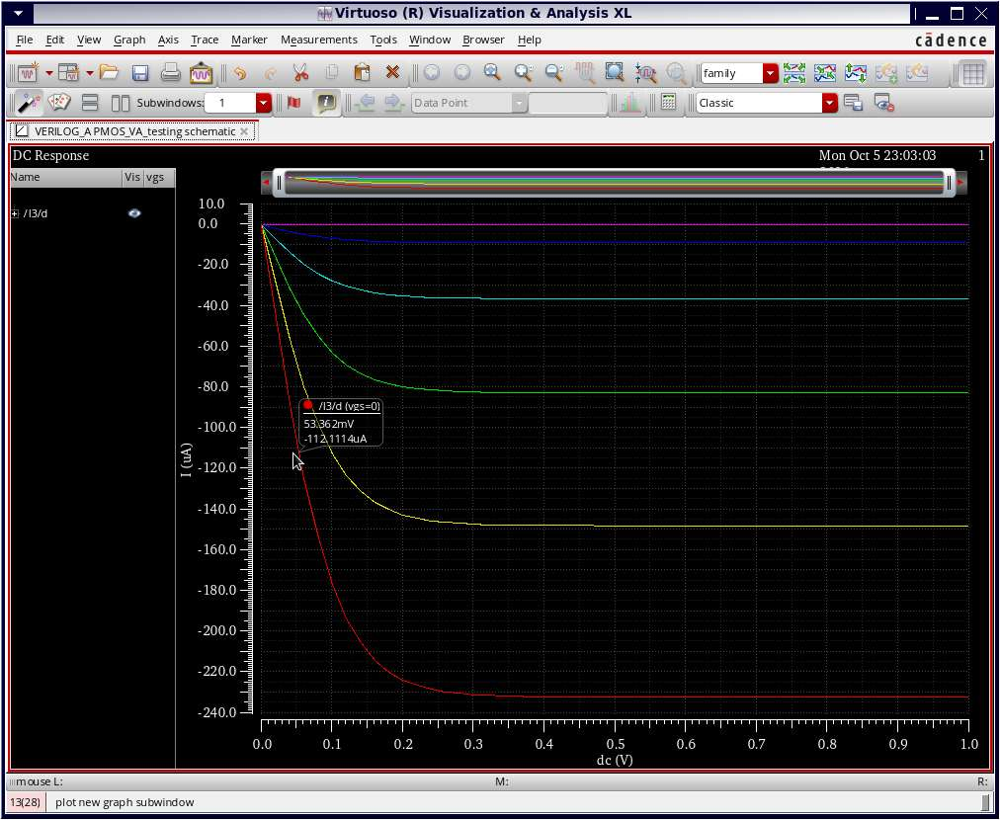
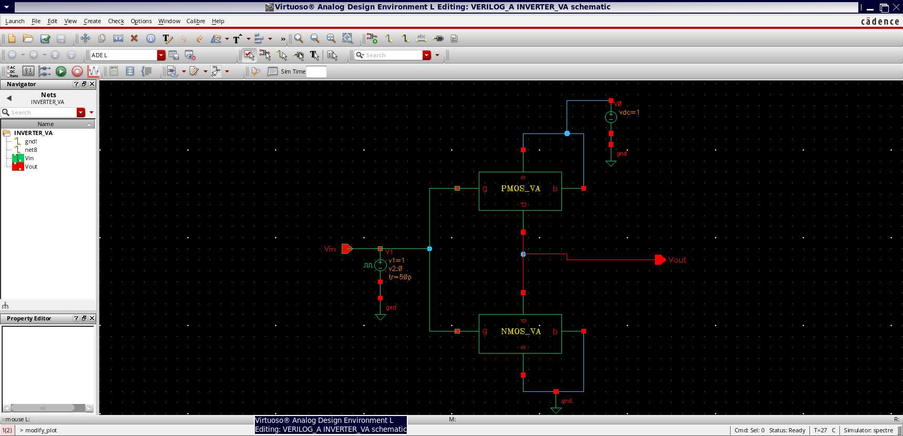
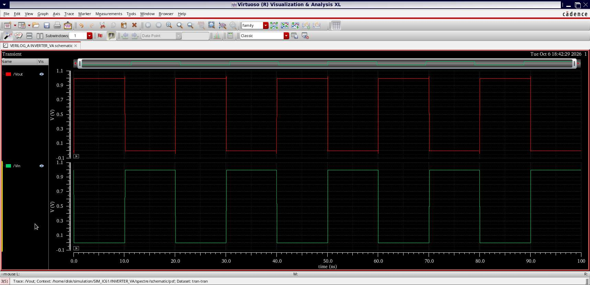
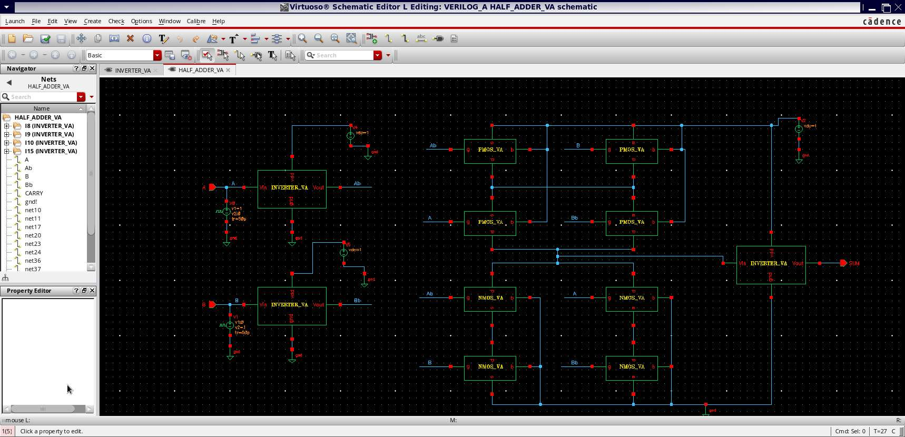
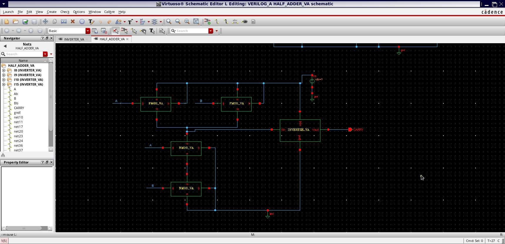
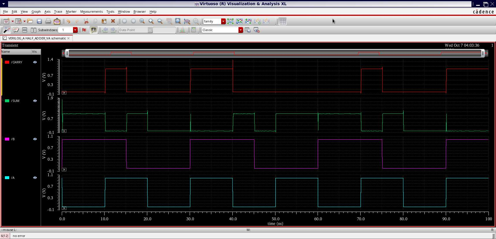

# NC-TFET Verilog-A Compact Models

Verilog-A compact models of an n-type and p-type **Negative Capacitance Tunnel FET (NC-TFET)**, with Cadence Virtuoso / Spectre simulations of single-device DC characteristics, an inverter and a half adder.

The device structure and equations follow:

> R. Ray et al., *"Analytical Modeling of the Ultra Short Channel Negative Capacitance Tunnel FET in Sub-Threshold Regime,"* 2025 Devices for Integrated Circuit (DevIC), Kalyani, India, 2025. DOI: [10.1109/DevIC63749.2025.11012587](https://doi.org/10.1109/DevIC63749.2025.11012587)

(The paper is not redistributed in this repo; please obtain it via IEEE Xplore.)

## Repository layout

```
.
├── models/
│   ├── nc_tfet_n.va          # n-type NC-TFET  (module nc_tfet_n)
│   └── nc_tfet_p.va          # p-type NC-TFET  (module nc_tfet_p)
├── sim/spectre/
│   ├── dc_nmos.scs           # Id-Vds sweep, stepped Vgs
│   ├── dc_pmos.scs           # |Id|-|Vds| sweep, stepped Vgs
│   └── inverter_tran.scs     # inverter transient, VDD = 1 V
├── scripts/plot_iv.py        # Python re-implementation of the DC equations
├── results/python_iv_check.png
├── docs/images/              # Cadence schematics and waveforms
├── requirements.txt
├── LICENSE
└── README.md
```

## Device parameters (from the paper)

| Parameter | Value |
|---|---|
| Channel length `LCH` | 10 nm |
| Silicon thickness `TSI` | 10 nm |
| Source / drain length | 20 nm each |
| Gate oxide (HfO2) `TOX` | 1 nm |
| Ferroelectric (Hf0.5Zr0.5O2) `TFE` | 5 nm |
| Doping: source / channel / drain | 8e19 / 5e17 / 5e18 cm^-3 |

## Model summary

1. Series oxide + silicon capacitance per unit area: `Cbase = Cox*Csi / (Cox + Csi)`
2. Bias-dependent ferroelectric capacitance: `Cfe = CFE0 / (1 + FE_NONLIN*|Vgs|)`, with `CFE0 < 0`
3. Internal gate voltage (NC amplification): `Vi = Vgs / (1 + Cbase/Cfe)`
4. Tunneling field: `E = phi_s / LTUN`
5. Kane-type BTBT generation: `R = A * E^P * exp(-B/E)`
6. `I_BTBT = q * W * LTUN * TSI * R`, with `I_D = I_BTBT * tanh(Vds/0.1) + I_SDT` (the tanh gives drain saturation)
7. Charge-based terminal currents with `ddt()` and junction capacitances (`CJ0`, `VJ`, `MJ`)

The p-type model is the n-type model with all terminal voltages and currents inverted. The two models differ only in `A_BTBT` (n: `1.0e19`, p: `1.8e19`), calibrated to the DC curves below.

## Running the simulations

### Cadence Virtuoso (ADE)
1. Create a cellview for each model and attach the `.va` file (or use `ahdl_include`).
2. Build the schematics shown in `docs/images/`.
3. Run DC sweeps (NMOS/PMOS) and transient (inverter, half adder) with Spectre.

### Spectre command line
```bash
cd sim/spectre
spectre dc_nmos.scs        -format psfascii +log dc_nmos.log
spectre dc_pmos.scs        -format psfascii +log dc_pmos.log
spectre inverter_tran.scs  -format psfascii +log inverter.log
```

### Python sanity check (no Cadence needed)
```bash
pip install -r requirements.txt
python scripts/plot_iv.py
```
This gives about 129 uA (n-type) and 232 uA (p-type) at |Vgs| = |Vds| = 1 V, matching the Spectre curves below.

## Results

### NMOS output characteristics



### PMOS output characteristics



### Inverter



### Half adder (CARRY = NAND + inverter; SUM from the XOR network)




The half adder was built in Virtuoso schematic form; there is no standalone netlist in this repo.

## Notes and known limitations

- `A_BTBT`, `B_BTBT`, `CFE0` and `FE_NONLIN` are empirical fitting parameters, not extracted from TCAD.
- Several declared parameters (`M_TUN`, `TFE`, `NSOURCE`, `NCHANNEL`, `NDRAIN`, `LSOURCE`, `LDRAIN`, `PHI_M`, `EPS_FE`) are not used in the current equations. `Eg_T` is computed but does not enter the BTBT expression.
- The charge currents use single-node `I(g)`, `I(d)`, `I(s)`, `I(b)` contributions (branches to ground). This is fine for the circuits here; for floating-node or more general circuits, consider branch contributions between terminals such as `I(g,s)`.
- The models were simulated with Spectre in Cadence Virtuoso; they have not been checked against other Verilog-A simulators.

## Authors & Contributors

- **Sohom Mondal** ([@SOHOM-MONDAL](https://github.com/SOHOM-MONDAL))
- **Subha Ghanta** ([@SubhaGhanta09](https://github.com/SubhaGhanta09))

## License

MIT, see [LICENSE](LICENSE).

